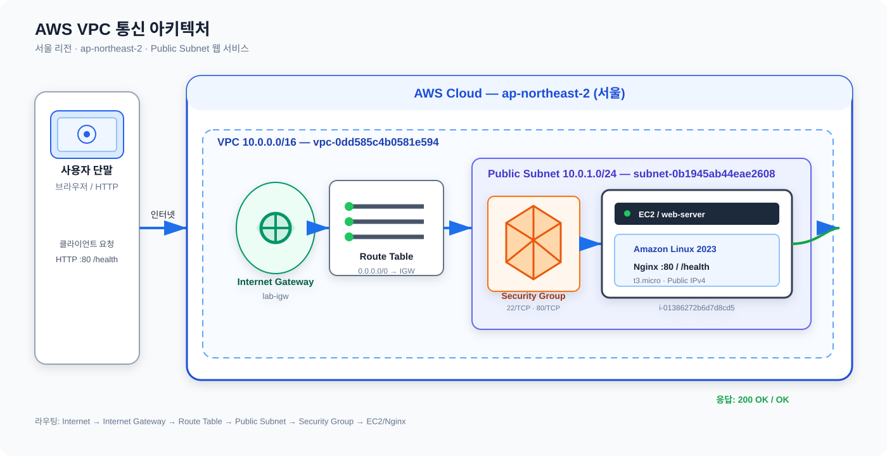
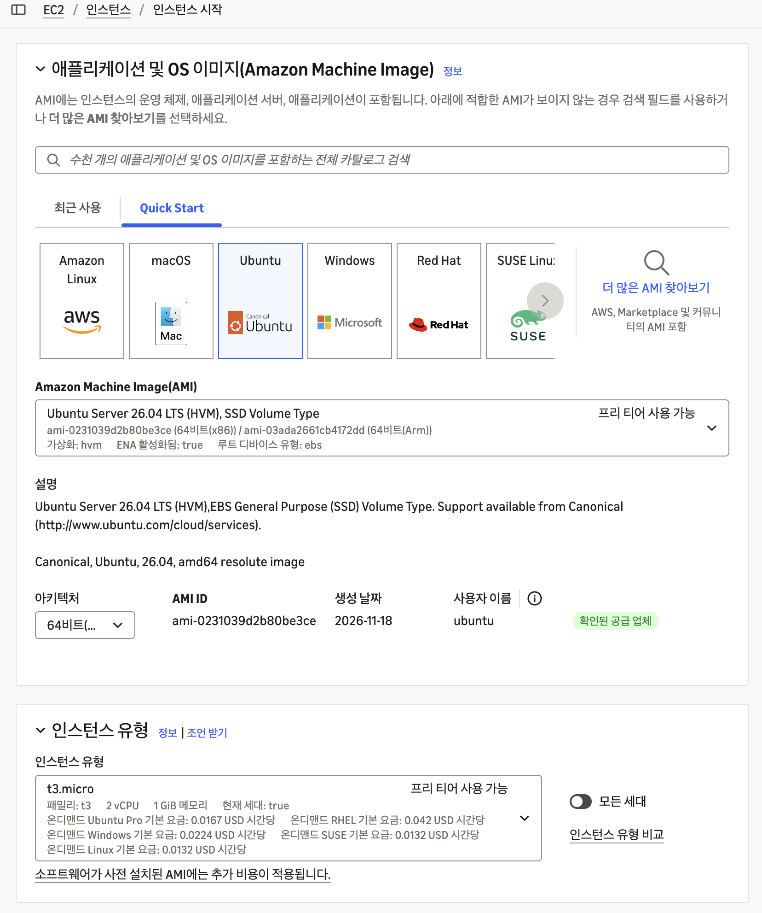

# AWS 클라우드 웹 서비스 배포 프로젝트

## 1. 프로젝트 개요

이 프로젝트는 EC2 인스턴스를 Public Subnet에 배치하고, VPC, Internet Gateway, Route Table, Security Group, IAM 정책을 구성하여 인터넷에 노출되는 웹 서비스를 안정적으로 운영하는 실습을 수행한 결과물입니다.

핵심 목표는 단순히 웹 애플리케이션을 실행하는 것이 아니라, 실제 클라우드 운영에서 필수적인 네트워크 격리, 최소 권한 보안, 외부 접근 경로 설계, 문제 해결 능력을 학습하는 것입니다.

- 리전: ap-northeast-2 (서울)
- 인스턴스: `i-0f67fdbe2276bf38a` (`web-server`)
- VPC: `vpc-0dd585c4b0581e594`
- Subnet: `subnet-0b1945ab44eae2608`
- Security Group: `sg-006f497ca2061e3c0` (`default`)
- 네트워크 구조: VPC + Public Subnet + Internet Gateway + Route Table
- 애플리케이션: Nginx 웹 서버
- 접근 방식: 외부 HTTP 요청을 Public EC2로 전달
- 보안 원칙: SSH는 본인 IP만 허용, HTTP는 80 포트만 공개
- IAM: 실습 작업에 필요한 최소 범위의 권한만 사용

---

## 2. 아키텍처 구성

### 2-1. 네트워크 설계

- VPC: 10.0.0.0/16
- Public Subnet: 10.0.1.0/24
- Internet Gateway: VPC에 연결
- Route Table: 0.0.0.0/0 -> Internet Gateway
- EC2 인스턴스: Public Subnet에 배치
- Security Group: 외부 접속 제어

### 2-2. 실행 흐름

사용자의 웹 브라우저 또는 외부 HTTP 요청이 다음 경로를 거쳐 EC2의 Nginx 서버로 도달합니다.

1. 인터넷에서 Public IP로 요청 전송
2. Internet Gateway가 VPC 내부로 트래픽 전달
3. Route Table의 기본 경로(0.0.0.0/0)로 Public Subnet으로 라우팅
4. EC2 인스턴스의 Security Group에서 80번 포트 허용 여부 검증
5. Nginx가 요청 처리 후 응답 반환

이 구조를 통해 단일 서버가 단순히 실행되는 것 이상으로, 네트워크 경계와 보안 정책이 실제 운영 환경에 가깝게 구현됩니다.

### 2-3. 아키텍처 다이어그램



---
## 3. 구성 상세

### 3-1. VPC
VPC는 클라우드 네트워크를 논리적으로 분리하는 기본 단위입니다. 이 프로젝트에서는 하나의 VPC를 생성하여 서비스 범위를 명확하게 구분하고, 서브넷과 보안 정책을 적용하는 기준으로 사용했습니다.

### 3-2. Public Subnet
Public Subnet에는 외부 인터넷과 직접 통신이 필요한 인스턴스를 배치합니다. EC2 웹 서버는 이 서브넷에 올려 Public IP를 통해 외부 요청을 받을 수 있도록 구성했습니다.

### 3-3. Internet Gateway
Internet Gateway는 VPC와 인터넷 사이의 게이트웨이 역할을 수행합니다. 이 리소스가 연결되어 있어야 외부에서 VPC 내부로 들어오는 트래픽이 허용됩니다.

### 3-4. Route Table
Route Table에서 0.0.0.0/0 → Internet Gateway 경로를 설정해 인터넷 트래픽이 VPC 내부로 전달되도록 구성했습니다. 이것이 있어야 Public Subnet 내 인스턴스가 외부 네트워크와 통신할 수 있습니다.

### 3-5. EC2 인스턴스
- 인스턴스 유형: t3.micro (프리티어/실습용)
- OS: Amazon Linux 2023
- 포트 공개: 80/TCP
- SSH: 본인 IP에서만 허용
- 접속 계정: ec2-user
- 패키지 관리자: dnf
- 웹 서버: Nginx 설치 및 실행

### 3-6. Security Group
보안 그룹은 EC2에 대한 네트워크 접근 제어를 담당합니다.

- Inbound 80/TCP: 0.0.0.0/0 허용
- Inbound 22/TCP: 본인 IP 또는 지정된 관리 IP 대역만 허용
- 전체 포트 허용(0-65535, 0.0.0.0/0)은 사용하지 않았으며, 최소한의 포트만 열어 운영 안전성을 확보했습니다.

이렇게 구성함으로써 불필요한 포트 노출을 줄이고, 보안상 취약한 상태를 피할 수 있습니다.

### 3-7. IAM 최소 권한 원칙
실습에 사용된 IAM 사용자 또는 역할은 EC2/VPC/SG 생성 및 조회에 필요한 범위만 허용하도록 제한했습니다.

- 허용 대상: EC2 생성/조회, VPC 생성/조회, Subnet, Route Table, Security Group, Tag, Attachment 관련 작업
- 비허용 대상: 실습과 무관한 S3, RDS, 관리자권한 등
- 관리자 권한(AdministratorAccess) 사용하지 않음

최소 권한 원칙은 실수로 전체 권한을 부여할 경우 발생하는 인프라 오남용, 보안 사고, 비용 낭비를 방지하기 위한 필수 원칙입니다.

---

## 4. 배포 및 실행 절차

아래는 AWS 콘솔 기준으로 실제로 서비스를 배포하는 절차를 정리한 상세 가이드입니다. CLI 예시도 함께 포함해 실습을 반복할 때 사용할 수 있도록 구성했습니다.

### 4-1. 사전 준비

1. AWS 콘솔 접속
   - 루트 계정 대신 별도 IAM 사용자로 로그인
   - 리전 선택: `Asia Pacific (Seoul) ap-northeast-2`
2. 실습용 IAM 사용자 생성
   - IAM > Users > Create user
   - 사용자 이름 예시: `cloud-lab-user`
   - AWS Management Console access 및 Programmatic access 선택
   - 권한은 최소 범위로 부여


     - 예: EC2 FullAccess, VPC FullAccess, IAMReadOnlyAccess 등
     - 실습 필요가 아닌 `AdministratorAccess`는 부여하지 않음


3. Key Pair 생성
   - EC2 > Key pairs > Create key pair
   - 이름 예시: `cloud-lab-key`
   - `.pem` 파일을 로컬에 저장하고 권한 설정 적용


```bash
chmod 400 cloud-lab-key.pem
```

### 4-2. VPC 생성

AWS 콘솔 메뉴 경로:
- VPC > Your VPCs > Create VPC

설정 예시:
- Name tag: `lab-vpc`
- IPv4 CIDR block: `10.0.0.0/16`
- Tenancy: Default

실제 VPC ID: `vpc-08ff8511b6dca33c0`


### 4-3. Public Subnet 생성

AWS 콘솔 메뉴 경로:
- VPC > Subnets > Create subnet

설정 예시:
- VPC: `vpc-0dd585c4b0581e594`
- Subnet name: `cd `
- Availability Zone: `ap-northeast-2a`
- IPv4 CIDR: `10.0.1.0/24`

실제 Subnet ID: `subnet-014ff9ae1d378cf0a`

다음 항목을 확인합니다.
- 서브넷이 VPC에 연결되어 있는지
- CIDR 범위가 겹치지 않는지


### 4-4. Internet Gateway 생성 및 연결

AWS 콘솔 메뉴 경로:
- VPC > Internet gateways > Create internet gateway

설정 예시:
- Name tag: `lab-igw`

생성 후 다음 절차를 수행합니다.
1. 생성된 IGW 선택
2. Actions > Attach to VPC
3. 연결할 VPC 선택: `vpc-0dd585c4b0581e594`

이 단계가 완료되어야 인터넷과 VPC 사이의 연결 경로가 활성화됩니다.

### 4-5. Route Table 생성 및 기본 경로 추가

AWS 콘솔 메뉴 경로:
- VPC > Route Tables > Create route table

설정 예시:
- Name: `public-route-table`
- VPC: `vpc-0dd585c4b0581e594`

다음으로 Route 추가:
- Destination: `0.0.0.0/0`
- Target: Internet Gateway (`lab-igw`) local

그리고 실제 Public Subnet을 해당 Route Table에 연결합니다.
- Subnet associations > Edit subnet associations
- `subnet-0b1945ab44eae2608` 선택

추가로 확인해야 하는 핵심 점은 다음입니다.
- 0.0.0.0/0 경로가 존재하는지
- 실제 Subnet이 연결된 route table이 맞는지


### 4-6. Security Group 생성

AWS 콘솔 메뉴 경로:
- EC2 > Security Groups > Create security group

실제 Security Group:
- Name: `lab-sg`
- Security Group ID: `sg-006f497ca2061e3c0`
- VPC: `vpc-0dd585c4b0581e594`

인바운드 규칙:
- HTTP: `80` / `0.0.0.0/0`
- SSH: `22` / 본인 IP 또는 지정된 관리망
  - `121.135.181.44/32`

주의 사항:
- `0.0.0.0/0` 전체 포트 허용 규칙은 사용하지 않음
- 운영용으로 SSH는 반드시 본인 IP로 제한

아웃바운드 규칙:
- 기본 설정인 `0.0.0.0/0` 허용으로 두는 것이 일반적

### 4-7. EC2 인스턴스 생성

AWS 콘솔 메뉴 경로:
- EC2 > Instances > Launch instance

설정 예시:
- Name: `web-server`
- Amazon Machine Image (AMI): Amazon Linux 2023 프리티어
- Instance type: `t3.micro`
- Key pair: `cloud-lab-key`
- Network settings:


- VPC: `vpc-0dd585c4b0581e594`
- Subnet: `subnet-0b1945ab44eae2608`
- Auto-assign public IP: Enable
- Security group: `sg-006f497ca2061e3c0` (`default`)
- Storage: 8~10 GiB


생성 후 인스턴스 정보를 확인합니다.
- 인스턴스 ID: `i-01386272b6d7d8cd5`
- 인스턴스 이름: `web-server`
- Public IPv4 주소: 실제 할당된 값 또는 Elastic IP




서브넷을 퍼블릭 서브넷으로 만들려면 
서브넷 라우팅 테이블의 경로를 
인터넷 게이트웨이에 추가하세요.


### 4-8. EC2 접속 및 웹 서버 설치

SSH 접속 명령 예시:

```bash
ssh -i cloud-lab-key.pem ec2-user@<Public-IP>
15.135.80.119
```

인스턴스 내부에서 Nginx를 설치하고 실행합니다.

```bash
sudo dnf update -y
sudo dnf install nginx -y
sudo systemctl enable --now nginx
```

로컬 검증:

```bash
curl -i http://localhost
sudo systemctl status nginx
```

정상 응답 예시:

```text
HTTP/1.1 200 OK
Server: nginx/1.24.0
```

### 4-9. 헬스 체크 엔드포인트 구성

Nginx에서 `/health` 경로를 정상 응답하도록 설정하면 외부 모니터링/검증이 쉬워집니다.

Amazon Linux 2023에서는 `/etc/nginx/conf.d/` 아래에 설정 파일을 생성합니다.

```bash
sudo tee /etc/nginx/conf.d/default.conf > /dev/null <<'EOF'
server {
    listen 80 default_server;
    listen [::]:80 default_server;
    server_name _;

    root /var/www;
    index index.html;

    location / {
        try_files $uri $uri/ =404;
    }

    location = /health {
        access_log off;
        default_type text/plain;
        add_header Content-Type text/plain;
        return 200 'OK\n';
    }
}
EOF

sudo nginx -t
sudo systemctl reload nginx
```

다음으로 로컬 검증:

```bash
curl -i http://localhost/health
```

응답 예시:

```text
HTTP/1.1 200 OK
Content-Type: text/plain

OK
```

### 4-10. 외부 접속 검증

브라우저 또는 터미널에서 다음을 실행해 외부 접근이 가능한지 확인합니다.

```bash
curl -i http://15.135.80.119/health
```

예상 결과:

```text
HTTP/1.1 200 OK

OK
```

이 결과를 통해 인터넷에서 EC2의 Nginx가 정상적으로 응답하는 것을 확인할 수 있습니다.

#### 외부 `/health` 접속 결과


#### 기본 Nginx 응답 결과


#### SSH 접속 및 로컬/외부 응답 검증


### 4-11. CLI 명령 전체 예시

아래는 동일 작업을 AWS CLI로 수행할 때의 대표 예시입니다.

```bash
aws ec2 create-vpc --cidr-block 10.0.0.0/16
aws ec2 create-subnet --vpc-id <VPC_ID> --cidr-block 10.0.1.0/24 --availability-zone ap-northeast-2a
aws ec2 create-internet-gateway
aws ec2 attach-internet-gateway --vpc-id <VPC_ID> --internet-gateway-id <IGW_ID>
aws ec2 create-route-table --vpc-id <VPC_ID>
aws ec2 create-route --route-table-id <RTB_ID> --destination-cidr-block 0.0.0.0/0 --gateway-id <IGW_ID>
aws ec2 run-instances \
  --image-id ami-xxxxxxxxxxxxxxxxx \
  --count 1 \
  --instance-type t3.micro \
  --key-name cloud-lab-key \
  --security-group-ids <SG_ID> \
  --subnet-id <SUBNET_ID>
```

### 4-12. 체크 포인트

배포가 완료되었는지 아래 항목을 모두 확인합니다.

- [ ] VPC 생성 완료
- [ ] Public Subnet 생성 완료
- [ ] Internet Gateway 연결 완료
- [ ] Route Table에 0.0.0.0/0 경로 존재
- [ ] EC2 인스턴스 생성 완료
- [ ] Public IP가 할당됨
- [ ] Security Group의 HTTP/SSH 규칙 적절히 설정됨
- [ ] Nginx 실행 상태 확인됨
- [ ] localhost 및 외부 URL 모두 응답 200 확인됨

---

## 5. 외부 접속 검증

아래 방식 중 B를 선택하여 외부 접근 가능 여부를 검증했습니다.

### 선택 방식: B. GET http://<퍼블릭IP>/health
15.135.80.119
- URL: http://<Public IP>/health
- 응답 상태: 200 OK
- 응답 본문: OK

예시:
```bash
curl -i http://<Public IP>/health
```

출력 예시:
```text
HTTP/1.1 200 OK
Content-Type: text/plain

OK
```

외부 접속 결과 스크린샷은 `docs/external-access-proof.png` 파일에 저장했습니다.

---

## 6. 헬스 체크 구성 예시

Nginx 기본 서버의 문서 루트는 `/var/www`로 설정하고, `/health`를 헬스 체크 응답으로 구성합니다.

```nginx
server {
    listen 80 default_server;
    listen [::]:80 default_server;
    server_name _;

    root /var/www;
    index index.html;

    location / {
        try_files $uri $uri/ =404;
    }

    location = /health {
        access_log off;
        default_type text/plain;
        add_header Content-Type text/plain;
        return 200 'OK\n';
    }
}
```

이 설정으로 `/var/www/index.html`이 기본 웹 문서로 제공되고, `/health`는 상태 확인에 사용됩니다.

---

## 7. 트러블슈팅 사례

실습 중 발생할 수 있는 대표적인 문제는 다음과 같습니다.

### 사례 1: SSH 접속 실패
- 증상: 인스턴스 생성 후 SSH 접속이 불가
- 가설: 보안 그룹 인바운드 규칙으로 본인 IP가 아닌 범위가 허용되었거나, 22 포트가 차단됨
- 검증: Security Group 규칙 및 인스턴스 상태 확인
- 조치: 22/TCP를 본인 IP로만 허용하도록 다시 설정
- 결과: SSH 접속 정상화

### 사례 2: 외부에서 HTTP 접근이 실패함
- 증상: Public IP로 연결 시 응답이 없음
- 가설: Route Table 경로 또는 Internet Gateway 연결 누락, 또는 Security Group 80 포트 차단
- 검증: 라우팅 테이블, IGW 연결 상태, SG 인바운드 규칙 확인
- 조치: 기본 경로 추가 및 80 포트 허용
- 결과: 웹 서버 응답 정상화

상세 내용은 `docs/troubleshooting.md` 파일에 정리했습니다.

---

## 8. 보안 및 운영 원칙

### 8-1. 최소 권한 원칙
- 필요하지 않은 권한은 부여하지 않음
- 실습 범위를 벗어난 서비스 권한은 사용하지 않음
- 한 번에 관리자 권한을 부여하지 않음

### 8-2. 네트워크 최소 공개 원칙
- 공개 포트는 HTTP 80만 허용
- SSH는 본인 IP만 허용
- 전체 포트 허용 규칙은 사용하지 않음

### 8-3. 과금 방지
- 실습 종료 후 생성한 리소스를 모두 정리
- EC2, EIP, VPC, IGW, EBS를 삭제 체크
- Billing Dashboard에서 과금 항목이 남지 않는지 최종 검증

---

## 9. 리소스 정리 체크리스트

아래 항목은 실습 종료 후 반드시 확인해야 합니다.

- [ ] EC2 인스턴스 종료
- [ ] EBS 볼륨 삭제
- [ ] Elastic IP 해제 및 Release
- [ ] Internet Gateway 연결 해제 및 삭제
- [ ] Route Table 정리
- [ ] Subnet 삭제
- [ ] VPC 삭제
- [ ] Security Group 정리
- [ ] Billing Dashboard에서 과금 항목 없음 확인

상세 사항은 `docs/cleanup-checklist.md` 파일에 정리했습니다.

---

## 10. 결과물 목록

- `docs/architecture.png` : VPC, Subnet, IGW, Route Table, EC2 구조 다이어그램
- `docs/external-access-proof.png` : 외부 응답 확인 스크린샷
- `docs/troubleshooting.md` : 오류 해결 보고서
- `docs/cleanup-checklist.md` : 정리 체크리스트

---

## 11. 정리

이번 프로젝트는 AWS 클라우드에서 네트워크와 보안을 실제로 구성해보며, 단순한 ‘웹 서비스 올리기’ 수준을 넘어 ‘실제 운영 환경을 구성하는 사고’를 익히는 과정입니다.

특히, 다음 세 가지가 가장 중요합니다.

1. VPC와 Subnet을 이용한 네트워크 구획화
2. Internet Gateway와 Route Table을 통한 외부 연결 구성
3. Security Group과 IAM 최소 권한 원칙을 적용한 보안 설계

이 과정을 통해 클라우드 환경에서 발생할 수 있는 연결 문제와 보안 문제를 로그와 증상을 근거로 분석하고 해결하는 역량을 키울 수 있습니다.

---

## 12. AWS CLI 자동 생성 및 삭제

생성 및 삭제 명령을 반복해서 사용할 수 있도록 스크립트로 저장했습니다.

- 생성 스크립트: `scripts/aws-lab-up.sh`
- 삭제 스크립트: `scripts/aws-lab-down.sh`
- 생성 리소스 상태 파일: `.aws-lab.env`

생성 스크립트는 다음 리소스를 생성합니다.

- VPC: `10.0.0.0/16`
- Public Subnet: `10.0.1.0/24`
- Internet Gateway
- Public Route Table과 `0.0.0.0/0 -> IGW` 경로
- Security Group
- EC2 Key Pair
- Amazon Linux 2023 EC2 인스턴스
- Nginx와 `/health` 엔드포인트

### 12-1. AWS CLI 준비

현재 폴더의 로컬 AWS CLI를 사용하려면 다음 경로를 PATH에 추가합니다.

```bash
export PATH="$PWD/.aws-cli-bin:$PATH"
aws --version
```

AWS 계정 인증이 필요합니다.

```bash
aws login
aws sts get-caller-identity
```

기존 Access Key 방식이라면 다음 명령을 사용합니다.

```bash
aws configure
```

입력 값 예시:

```text
AWS Access Key ID: <IAM 사용자의 Access Key ID>
AWS Secret Access Key: <IAM 사용자의 Secret Access Key>
Default region name: ap-northeast-2
Default output format: json
```

### 12-2. 환경 생성

실행 권한은 이미 설정되어 있습니다.

```bash
./scripts/aws-lab-up.sh
```

생성 과정이 끝나면 `.aws-lab.env` 파일에 다음 값이 저장됩니다.

```text
VPC_ID
SUBNET_ID
IGW_ID
RTB_ID
SG_ID
INSTANCE_ID
PUBLIC_IP
KEY_NAME
```

생성 상태를 확인합니다.

```bash
source .aws-lab.env

aws ec2 describe-instances \
  --instance-ids "$INSTANCE_ID" \
  --query 'Reservations[0].Instances[0].[InstanceId,State.Name,PublicIpAddress]' \
  --output table
```

### 12-3. EC2 테스트

헬스 체크 엔드포인트를 테스트합니다.

```bash
source .aws-lab.env
curl --retry 12 --retry-delay 10 -i "http://$PUBLIC_IP/health"
```

정상 응답:

```text
HTTP/1.1 200 OK
Content-Type: text/plain

OK
```

SSH 접속을 테스트합니다.

```bash
source .aws-lab.env
ssh -i cloud-lab-key.pem ec2-user@"$PUBLIC_IP"
```

### 12-4. 인스턴스 중지 및 재시작

인스턴스만 중지하려면 다음 명령을 실행합니다.

```bash
source .aws-lab.env
aws ec2 stop-instances --instance-ids "$INSTANCE_ID"
aws ec2 wait instance-stopped --instance-ids "$INSTANCE_ID"
```

인스턴스를 다시 시작합니다.

```bash
source .aws-lab.env
aws ec2 start-instances --instance-ids "$INSTANCE_ID"
aws ec2 wait instance-running --instance-ids "$INSTANCE_ID"

PUBLIC_IP=$(aws ec2 describe-instances \
  --instance-ids "$INSTANCE_ID" \
  --query 'Reservations[0].Instances[0].PublicIpAddress' \
  --output text)

echo "$PUBLIC_IP"
```

재시작 시 퍼블릭 IPv4 주소가 변경될 수 있습니다.

### 12-5. 전체 리소스 삭제

생성된 실습 리소스를 역순으로 삭제합니다.

```bash
./scripts/aws-lab-down.sh
```

삭제 스크립트는 다음 순서로 리소스를 정리합니다.

1. EC2 인스턴스 종료 대기
2. Subnet과 Route Table의 명시적 연결 해제
3. Security Group 삭제
4. Subnet 삭제
5. Route Table 삭제
6. Internet Gateway를 VPC에서 분리 후 삭제
7. VPC 삭제
8. EC2 Key Pair 및 로컬 프라이빗 키 삭제

삭제 후 확인합니다.

```bash
source .aws-lab.env 2>/dev/null || true

aws ec2 describe-vpcs \
  --filters Name=tag:Name,Values=lab-vpc \
  --query 'Vpcs[].VpcId'

aws ec2 describe-instances \
  --filters Name=tag:Name,Values=web-server \
  --query 'Reservations[].Instances[].{ID:InstanceId,State:State.Name}'
```

`source` 전에 `.aws-lab.env`가 삭제될 수 있으므로 삭제 확인 명령은 독립적으로 실행해도 됩니다.

---

## 13. 참고

본 저장소는 실습 문서 정리용 결과물로 구성되며, 실제 AWS 실제 계정과 연결되어 있지 않습니다. 실제 운영 환경에서는 AWS 콘솔에서 값과 리소스 상태를 직접 확인하고, 배포/정리 절차를 반복하면서 안전하게 진행하는 것이 중요합니다.

#### IAM 권한 설정

현재 사용자는 AWS CLI 자격 증명은 정상적으로 인증되지만, EC2/VPC 리소스를 생성할 권한이 없습니다.
다음 오류가 발생하면 IAM 정책 연결이 필요합니다.

```text
UnauthorizedOperation: You are not authorized to perform: ec2:CreateVpc
```

AWS 콘솔에서 다음 순서로 권한을 부여합니다.

1. AWS 콘솔에 관리자 권한으로 로그인
2. **IAM → Policies → Create policy** 이동
3. **JSON** 선택
4. `docs/aws-lab-iam-policy.json`의 내용을 붙여넣기
5. 정책 이름을 `AWSLabCliPolicy`로 지정하고 생성
6. **IAM → Users → cloud-lab-user → Permissions → Add permissions** 이동
7. **Attach policies directly** 선택
8. `AWSLabCliPolicy` 연결
9. 콘솔 또는 다음 명령으로 권한과 인증을 확인

```bash
aws sts get-caller-identity
```

권한은 필요한 리소스 범위로 제한하는 것이 좋습니다. 실습이 끝나면 정책을 분리하거나 사용자와 정책을 삭제할 수 있습니다.

액세스 키는 CSV 파일이 아닌 AWS CLI 자격 증명 파일로만 보관합니다.

```bash
aws configure
chmod 600 ~/.aws/credentials ~/.aws/config
```

권한 적용 후 생성 스크립트를 다시 실행합니다.

```bash
./scripts/aws-lab-up.sh
```

---

## 14. 웹 서비스 설치 위치

Linux에서 웹 서비스를 운영할 때는 프로그램의 종류와 배포 방식에 따라 다음 위치를 사용하는 것이 일반적입니다.

| 용도 | 권장 위치 | 예시 |
|---|---|---|
| 정적 웹 파일 | `/var/www/<서비스명>` | `/var/www/myapp` |
| 애플리케이션 실행 파일 | `/opt/<서비스명>` | `/opt/myapp` |
| 애플리케이션 데이터 | `/var/lib/<서비스명>` | `/var/lib/myapp` |
| 시스템 서비스 설정 | `/etc/systemd/system/` | `myapp.service` |
| Nginx 설정 | `/etc/nginx/conf.d/` | `/etc/nginx/conf.d/myapp.conf` |
| 로그 | `/var/log/nginx/` 또는 `/var/log/<서비스명>/` | `/var/log/nginx/access.log` |
| 임시 업로드 파일 | `/var/tmp/` 또는 `/var/spool/<서비스명>/` | 업로드 처리 전용 임시 저장소 |

아래는 일반적인 배포 구조입니다.

```text
/opt/myapp/          애플리케이션 실행 파일 또는 서버 프로그램
/var/www/myapp/      정적 HTML, CSS, JavaScript 파일
/etc/nginx/conf.d/   Nginx 가상 호스트 및 프록시 설정
/var/log/nginx/      Nginx 접속 및 오류 로그
/var/lib/myapp/      애플리케이션 데이터 및 영구 저장 파일
```

### 14-1. 정적 웹 사이트

React, Vue, HTML/CSS/JavaScript 빌드 결과물은 일반적으로 다음 위치에 배치합니다.

```text
/var/www/myapp/
```

예를 들어 빌드된 파일을 배포하는 경우입니다.

```bash
sudo mkdir -p /var/www/myapp
sudo cp -r dist/. /var/www/myapp/
sudo nginx -t
sudo systemctl reload nginx
```

Nginx 설정 예시:

```nginx
server {
    listen 80;
    server_name _;

    root /var/www/myapp;
    index index.html;

    location / {
        try_files $uri $uri/ /index.html;
    }
}
```

설정 파일은 다음 위치에 저장합니다.

```text
/etc/nginx/conf.d/myapp.conf
```

### 14-2. 애플리케이션 서버

Spring Boot, Node.js, Python 애플리케이션은 일반적으로 다음 위치에서 실행합니다.

```text
/opt/myapp/
```

예:

```text
/opt/myapp/app.jar
/opt/myapp/server.js
/opt/myapp/app.py
```

애플리케이션은 기본적으로 다음과 같이 별도 포트에서 실행합니다.

```text
애플리케이션: 127.0.0.1:8080
Nginx:       0.0.0.0:80
```

Nginx는 외부 요청을 애플리케이션의 내부 포트로 전달합니다.

```nginx
server {
    listen 80;
    server_name _;

    location / {
        proxy_pass http://127.0.0.1:8080;
        proxy_set_header Host $host;
        proxy_set_header X-Real-IP $remote_addr;
        proxy_set_header X-Forwarded-For $proxy_add_x_forwarded_for;
        proxy_set_header X-Forwarded-Proto $scheme;
    }
}
```

### 14-3. `/health` 경로 위치

이 실습의 `/health`는 실제 폴더가 아니라 Nginx의 위치 설정입니다.

```text
실제 설정 파일: /etc/nginx/conf.d/default.conf
기본 문서 루트: /var/www
가상 요청 경로: /health
```

설정 내용:

```nginx
root /var/www;
index index.html;

location = /health {
    access_log off;
    default_type text/plain;
    add_header Content-Type text/plain;
    return 200 'OK\n';
}
```

따라서 `/health`는 별도의 `/var/www/health` 폴더가 필요 없는 가상 경로입니다.

```bash
curl -i http://localhost/
curl -i http://localhost/health
curl -i http://15.135.80.119/
curl -i http://15.135.80.119/health
sudo nginx -T | grep -n -B2 -A8 'location = /health'
sudo cat /etc/nginx/conf.d/default.conf
```

---

## 15. 확장성 및 비용 대응 방안

단일 EC2 구조는 실습과 소규모 서비스에는 적합하지만, 트래픽 증가 시 단일 장애점과 자원 포화 문제가 발생할 수 있습니다.

### 15-1. 병목 식별 방법

CloudWatch 지표와 애플리케이션 로그를 함께 확인하여 병목 지점을 분류합니다.

| 계층 | 확인 지표 | 병목 판단 기준 | 대응 방향 |
|---|---|---|---|
| EC2 인스턴스 | CPUUtilization, NetworkIn/Out, StatusCheckFailed | CPU가 장기간 70% 이상 또는 상태 검사 실패 | 인스턴스 유형 상향 또는 오토 스케일링 검토 |
| Nginx | 접속 응답 시간, 5xx 비율, 활성 연결 수 | 응답 지연 또는 5xx 증가가 지속됨 | 워커 설정·캐싱·프록시 대상을 점검 |
| 애플리케이션 | 요청 처리 시간, 큐 대기 시간, 오류율 | 애플리케이션 지연이 네트워크 지표보다 먼저 증가 | 애플리케이션 프로파일링 및 코드 최적화 |
| 네트워크/보안 | 연결 거부, 타임아웃, Security Group 흐름 | 특정 포트 또는 경로에서만 실패 | 라우팅, SG, IGW와 대상 상태 확인 |

권장 사항:
- 장애 전후 지표를 같은 시간대에 비교해 원인을 식별합니다.
- 평균값뿐 아니라 p95 또는 p99 응답 시간과 최대값을 확인합니다.
- `/health`에는 단순 상태만 반환하고, 데이터베이스·외부 API를 과도하게 검사하지 않습니다.
- 긴 장애 조사를 위해 EC2 또는 Nginx 로그를 CloudWatch Logs에 보관합니다.

### 15-2. ALB 도입 계획

현재는 실습 구조를 유지하기 위해 단일 EC2와 Nginx로 구성합니다. 다음 조건 중 하나 이상이 충족되면 Application Load Balancer(ALB)를 도입합니다.

- 단일 EC2의 CPU 또는 메모리 사용량이 지속적으로 높음
- 여러 인스턴스로 확장하거나 무중단 배포가 필요함
- `/health`를 기반으로 비정상 인스턴스에서 트래픽을 분리해야 함
- HTTPS 종단, 호스트 기반 라우팅, 또는 다중 서비스 라우팅이 필요함

권장 단계:
1. Public Subnet 또는 별도의 가용 영역 서브넷에 ALB를 배치합니다.
2. HTTP와 HTTPS 리스너를 구성하고 ALB 보안 그룹은 80/443만 허용합니다.
3. `/health`를 대상으로 Target Group 헬스 체크를 설정합니다.
4. EC2 인스턴스를 Target Group에 등록하거나 Auto Scaling Group과 연동합니다.
5. 응답 지연, 비정상 대상 수, HTTP 5xx가 임계치를 넘을 때 알람을 설정합니다.

### 15-3. 비용 추적 및 알림 전략

AWS 리소스에는 목적과 비용 추적이 가능하도록 태그를 일관되게 적용합니다.

권장 태그 예시:

| 태그 키 | 예시 값 | 용도 |
|---|---|---|
| `Project` | `cloud-lab` | 프로젝트별 비용 구분 |
| `Environment` | `lab` 또는 `prod` | 환경별 비용 구분 |
| `Owner` | `cloud-lab-user` | 담당자 식별 |
| `CostCenter` | `training` | 부서 또는 비용 센터 그룹 |
| `AutoStop` | `enabled` | 실습 종료 시 자동 중지 대상 표시 |

비용 대응 전략:
- 실습용 EC2는 사용하지 않을 때 중지하고, 종료 시 EBS와 Elastic IP를 함께 정리합니다.
- 예산 알림은 무료 한도와 인스턴스 규모에 맞춰 월 예산의 50%, 80%, 100% 도달 시 알림을 설정합니다.
- Billing > Budgets에 AWS Budget을 생성하고 이메일 또는 SNS 알림을 연결합니다.
- Cost Explorer에서 `Project`, `Environment`, `Owner` 태그 기준으로 일일/월별 비용을 확인합니다.
- CloudWatch 또는 SNS 알람은 비용 이상 징후뿐 아니라 EC2 상태, 네트워크 오류, CPU 임계치와 연계합니다.
- 실습 종료 후에는 `aws-lab-down.sh`를 실행하여 과금 가능 리소스가 남지 않았는지 확인합니다.

간단한 운영 임계치 예시:
- EC2 CPUUtilization 15분 평균이 70% 이상이면 확장 검토
- 응답 시간 p95가 1초 이상이거나 5xx 비율이 5분간 5% 이상이면 장애 원인 조사
- 월 예산의 80% 도달 시 즉시 검토 알림, 100% 도달 시 긴급 알림
